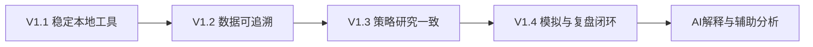

# 项目后续路线

更新：2026-10-24。V1.1的目标是可靠地展示真实数据、执行模拟盘和保留审计依据。发布信息以[V1.1官方发布页](https://github.com/stevenrenOvO/personal-ai-trading-copilot/releases/tag/v1.1)为准。后续按数据、研究、复盘、AI逐层推进。

| 阶段 | 优先做什么 | 交付与完成标准 |
|---|---|---|
| V1.1 发布 | 固定版本、锁定依赖、首装/升级、数据状态、订单恢复、页面验证、ZIP与摘要 | 全量回归通过；新目录可离线演示；本地行情首屏有数据；发布包不含用户资料；源码、`v1.1`标签与Release附件保持一致 |
| V1.2 数据基础 | 每条记录来源与更新时间、历史ST/上市/退市状态、复权/公司行动、行业随日期变化、停牌资格、可恢复任务队列 | 同一交易日可重现；数据缺失与来源切换可查询；按生效日使用证券状态；覆盖报告区分未知与真实零值 |
| V1.3 研究平台 | 机会页、回测和AI共享策略条件；固定研究样本；独立时间段验证；费用/滑点/流动性敏感性分析；基准对照 | 交易账本与权益对账；明确每项数据限制；同时报告收益、回撤、换手、平仓样本和无法成交率；保留失败结果 |
| V1.4 个人复盘 | 观察池、计划执行对比、分批仓位、事件时间线、纪律与偏差统计、复盘导出 | 每条建议和操作都能追到日期及依据；分清手工决策与真实模拟成交；样本不足时不给确定性评价 |
| 后续AI | 在结构化工具稳定后接入可替换LLM、引用数据来源、解释风险和执行差异、回答复盘问题 | 答案能指向原始记录；工具缺数据时保留未知；模型解释不直接改变账户或替代成交风控 |

## 近期建议顺序

1. 维护V1.1这个范围清楚的本地版本，持续收集首次安装、日期切换、数据源中断和模拟盘使用问题。
2. V1.2优先补真实历史证券状态与公司行动。现有研究的ST、退市与复权缺口会影响结论，这些数据比继续增加评分项更紧迫。
3. 数据条件具备后，再让机会页和回测使用完全相同的筛选与执行假设。固定验证流程，逐项测试环境、板块、梯队等条件的增益。
4. 用模拟盘积累足够的闭环记录，再发展个人画像与AI复盘。当前固定样本中的两套策略收益为负，应保留这一结果并据此研究，不能把界面完成解释成策略已有效。

## 适合持续保留的工程规则

- 每次修复必须有能暴露原问题的验证，页面测试要检查真实内容和日期，不能只检查HTTP 200。
- 发布记录包含版本、源码/依赖、数据样本和配置；未完成能力应能从界面看到。
- 默认本地运行，测试、演示和实际账户使用独立目录。
- 若转为多人或公网产品，再单独设计身份验证、权限、账户事务、部署和监控；当前源码发布不等于公网部署。
