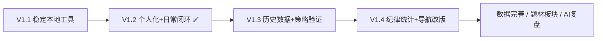

# 项目后续路线

更新：2026-11-17。V1.2 已完成（[V1.2发布页](https://github.com/stevenrenOvO/personal-ai-trading-copilot/releases/tag/v1.2)，说明见 `V1.2-发布说明.md`、验收见 `V1.2-验收清单.md`）：「我的账户」形成观察池 → 规则状态 → 交易前检查 → 真实成交 → 收盘后计划的日常闭环；收盘后用全市场快照一次写入当日日线。下一步为 V1.3。V1.1 已发布（[V1.1官方发布页](https://github.com/stevenrenOvO/personal-ai-trading-copilot/releases/tag/v1.1)）。

后续方向调整：系统从“短线情绪看盘工具”转向“个人波段交易体系的执行与审计工具”。顺序为先让系统按真实账户和个人规则运行，再验证策略，最后形成决策审计闭环。

| 阶段 | 优先做什么 | 交付与完成标准 |
|---|---|---|
| V1.2 个人化+日常闭环（✅ 已完成） | ① 恢复运行：补齐最新日线、全量回归；② 个人风控参数文件：账户资金（默认12,000元，可改）、单笔风险1–2%、单票≤20%、首仓10–15%、按市场状态限制总仓位；原100万模拟账户保留作研究用；③ 仓位计算器：按买入价与止损价、整手和最低佣金算可买手数、风险金额与占比，买不起一手或超限明确提示；④ 观察池（≤10只）；⑤ 按个人波段规则给出逐只状态：周线收盘在向上的13周均线之上；日线MACD回零轴附近、绿柱缩短、金叉放量；有效跌破21日均线离场；盈利<15%按21日线、>15%从最高价回撤10%离场；⑥ 交易前检查：规则是否满足、可买手数、总仓位余量；⑦ 真实交易与持仓记录，与模拟盘分开；收盘后计划表（新候选最多3只）可存为当日“计划”；⑧ 观察池股票复权 | 小资金账户下真实股票的手数计算与手算一致；风控参数改动无需改代码；观察池每只都有可追溯的状态依据；计划与真实操作都能按日期查到 |
| V1.3 历史数据+策略验证 | 补齐全市场2–3年日线与复权因子；成交额补全；入库换手率、ST、停牌状态并识别停牌，不再无限重试；逐条记录数据来源；波段规则回测（收益、最大回撤、胜率、盈亏比、平仓样本、对照沪深300、样本外区间）；个股K线/均线/MACD图并标出入场条件与止损线 | 回测与日常状态判断使用同一套规则代码；结果不佳也如实保留 |
| V1.4 纪律统计+导航改版 | 计划与执行对比、偏差类型（提前埋伏、未止损、仓位超限、追高）、纪律遵守率与偏差盈亏；导航改为今日 / 持仓 / 观察池 / 计划 / 复盘 / 研究；机会页默认只展示前3只；情绪周期改为环境过滤 | 每条建议和操作都能追到日期及依据；样本不足时不给确定性评价 |
| 后续 | 历史ST/上市/退市、行业随日期变化、题材/概念板块、AI复盘（只读工具、引用原始记录） | 同一交易日可重现；AI答案能指向原始记录，不直接改变账户 |

## 调整说明

- 系统核心从“短线情绪看盘”转为“个人波段体系的执行与审计”。最先交付每天都能用的闭环：观察池 → 按规则判断状态 → 交易前检查 → 记录真实操作 → 复盘。
- 日常判断只需最近数月日线（21日线、MACD、13周均线），因此V1.2只对观察池股票做复权；全市场长历史只服务于回测，放到V1.3。
- 小资金下单笔风险、单票上限与一手限制会互相冲突，必须在下单前算出并提示。
- 本金较小，真实交易记录比模拟盘更能暴露执行偏差；系统主要追踪过程指标（是否按计划、是否按止损、仓位是否超限），回本进度仅作参考。
- 冻结样本中现有两套策略收益为负，应保留这一结果，不能把界面完成解释成策略已有效。

## 适合持续保留的工程规则

- 每次修复必须有能暴露原问题的验证，页面测试要检查真实内容和日期，不能只检查HTTP 200。
- 新功能尽量新增文件，不重构运行正常的模块。
- 发布记录包含版本、源码/依赖、数据样本和配置；未完成能力应能从界面看到。
- 默认本地运行，测试、演示、研究账户和小资金账户使用独立目录。
- 若转为多人或公网产品，再单独设计身份验证、权限、账户事务、部署和监控；当前源码发布不等于公网部署。

## V1.2 留给 V1.3 的事项

- 软件关闭期间产生的历史缺口仍需逐只补数（数小时）；V1.3 补齐全市场长历史时一并解决，可考虑按日期批量取数的数据源。
- 波段规则阈值（零轴附近 2%、放量 1.2 倍、有效跌破 1% 或连续 2 天）为 V1.2 的解释，V1.3 回测应使用同一份 `band_rules.py` 验证并视结果调整。
- 冷启动全市场结构计算约 50 秒，可做收盘后预计算。
