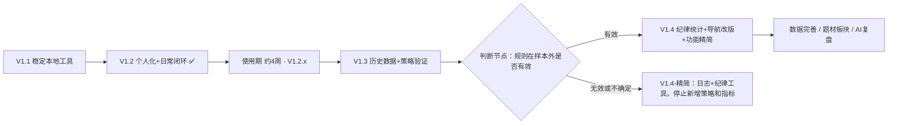

# 项目后续路线

更新：2026-11-17。V1.2 已完成（[V1.2发布页](https://github.com/stevenrenOvO/personal-ai-trading-copilot/releases/tag/v1.2)，说明见 `V1.2-发布说明.md`、验收见 `V1.2-验收清单.md`）：「我的账户」形成观察池 → 规则状态 → 交易前检查 → 真实成交 → 收盘后计划的日常闭环；收盘后用全市场快照一次写入当日日线。V1.2.1 补丁修复复权数据串行超时、次日补写快照、涨跌停检查、快照来源记录被覆盖，并恢复前端交互测试（见 `V1.2.1-发布说明.md`）。V1.2.2 完成日常可用性更新：按“每天收盘后看一次、次日按单执行”设计执行单（限价买入、止损条件单、勾选执行），持仓并入观察池，股票名称输入，分区精简，紧凑交易日选择（见 `V1.2.2-发布说明.md`）。V1.2.3 根据首次试用反馈简化界面：导航分为每日操作与市场研究两组，今日页加盘面摘要，一句话结论和大白话指令（见 `V1.2.3-发布说明.md`）。下一步为约 4 周的使用期（期间只发 1.2.x 修复，并加入本机页面使用记录），之后进入 V1.3 并在结尾设判断节点，见下表。V1.1 已发布（[V1.1官方发布页](https://github.com/stevenrenOvO/personal-ai-trading-copilot/releases/tag/v1.1)）。

后续方向调整：系统从“短线情绪看盘工具”转向“个人波段交易体系的执行与审计工具”。顺序为先让系统按真实账户和个人规则运行，再验证策略，最后形成决策审计闭环。

| 阶段 | 优先做什么 | 交付与完成标准 |
|---|---|---|
| V1.2 个人化+日常闭环（✅ 已完成） | ① 恢复运行：补齐最新日线、全量回归；② 个人风控参数文件：账户资金（默认12,000元，可改）、单笔风险1–2%、单票≤20%、首仓10–15%、按市场状态限制总仓位；原100万模拟账户保留作研究用；③ 仓位计算器：按买入价与止损价、整手和最低佣金算可买手数、风险金额与占比，买不起一手或超限明确提示；④ 观察池（≤10只）；⑤ 按个人波段规则给出逐只状态：周线收盘在向上的13周均线之上；日线MACD回零轴附近、绿柱缩短、金叉放量；有效跌破21日均线离场；盈利<15%按21日线、>15%从最高价回撤10%离场；⑥ 交易前检查：规则是否满足、可买手数、总仓位余量；⑦ 真实交易与持仓记录，与模拟盘分开；收盘后计划表（新候选最多3只）可存为当日“计划”；⑧ 观察池股票复权 | 小资金账户下真实股票的手数计算与手算一致；风控参数改动无需改代码；观察池每只都有可追溯的状态依据；计划与真实操作都能按日期查到 |
| 使用期（V1.2.x，约4周） | 每个交易日按闭环使用：观察池 → 规则状态 → 交易前检查 → 记录真实成交（含计划外交易）→ 收盘后计划；1.2.x 增加本机页面使用记录（各页面和操作的打开次数与日期，只存本地、不联网），供功能取舍；随手记录不顺手之处，作为 V1.4 导航改版的依据；期间只发修复补丁，不加新功能 | 至少 20 个交易日的真实使用记录；每笔真实成交都有计划标注；形成按页面统计的使用次数和问题清单 |
| V1.3 历史数据+策略验证 | 补齐全市场2–3年日线与复权因子；成交额补全；入库换手率、ST、停牌状态并识别停牌，不再无限重试；逐条记录数据来源；波段规则回测（收益、最大回撤、胜率、盈亏比、平仓样本、对照沪深300、样本外区间）；规则条件有效性检验：把每个条件（周线在上升13周线之上、DIF零轴附近、绿柱缩短、金叉放量、21日线位置）当作因子，比较满足与不满足时未来5/10/20日收益、胜率和分布，按年份分段看是否稳定，并据此检验阈值；个股K线/均线/MACD图并标出入场条件与止损线 | 回测、条件检验与日常状态判断使用同一套规则代码；每个条件都有样本内外的检验结果，样本不足时注明；结果不佳也如实保留；**给出判断节点结论**：样本外扣除费用后期望收益为正、最大回撤在可接受范围、且优于不满足条件的对照组，才判为“有效”；样本外平仓少于 30 笔时判为“不确定”，按无效路线处理 |
| V1.4 纪律统计+导航改版（规则有效时） | 计划与执行对比、偏差类型（提前埋伏、未止损、仓位超限、追高）、纪律遵守率与偏差盈亏；**首页以纪律遵守率为核心指标**（按计划、按止损、仓位不超限的比例），回本进度只作参考；首页显示“今天要做的事”：触发离场的持仓、出现买点的观察池股票、当日计划；**完整导航改版放在这里**：在 1.2.2「今日 · 账户」的基础上，把今日、持仓、观察池、计划提升为一级导航，市场/机会/涨停环境/回测/AI 归入「研究」，导航改为今日 / 持仓 / 观察池 / 计划 / 复盘 / 研究——以使用期记录为依据决定各页去留与顺序；机会页默认只展示前3只；情绪周期改为环境过滤；**按使用期的使用记录精简功能**：4 周内未使用的页面隐藏或下线，不再维护 | 每条建议和操作都能追到日期及依据；样本不足时不给确定性评价；下线的功能在发布说明中列明，数据保留 |
| V1.4-精简（规则无效或不确定时） | 停止在策略、指标、情绪和板块分析上继续投入；系统收缩为“交易日志 + 纪律检查”：保留风控参数、仓位计算、交易前检查（去掉规则条件或改为自定义清单）、真实成交、计划与复盘、纪律遵守率；其余模块隐藏，代码与数据保留以便日后恢复；可回到 V1.3 修改规则后重新验证 | 验证结论与原始数据随版本发布；保留的功能都有每日使用记录支撑；系统不再输出未经验证的买卖信号 |
| 后续 | 历史ST/上市/退市、行业随日期变化、题材/概念板块、AI复盘（只读工具、引用原始记录） | 同一交易日可重现；AI答案能指向原始记录，不直接改变账户 |

## 调整说明

- 系统核心从“短线情绪看盘”转为“个人波段体系的执行与审计”。最先交付每天都能用的闭环：观察池 → 按规则判断状态 → 交易前检查 → 记录真实操作 → 复盘。
- 日常判断只需最近数月日线（21日线、MACD、13周均线），因此V1.2只对观察池股票做复权；全市场长历史只服务于回测，放到V1.3。
- 小资金下单笔风险、单票上限与一手限制会互相冲突，必须在下单前算出并提示。
- 本金较小，真实交易记录比模拟盘更能暴露执行偏差；系统主要追踪过程指标（是否按计划、是否按止损、仓位是否超限），回本进度仅作参考。
- 冻结样本中现有两套策略收益为负，应保留这一结果，不能把界面完成解释成策略已有效。

## 项目定位与价值判断（2026-11-18）

- **当前价值在执行，不在信号**：对 1.2 万元小账户，主要风险是仓位过重、追高、不止损和计划外交易；仓位计算、交易前检查、真实成交与计划对比直接针对这些问题，这是现阶段最实在的使用价值。
- **规则是否有效尚未证明**：系统保证“按规则做”，不保证“规则对”；现有两套策略在冻结样本中为负收益，波段规则尚未回测。V1.3 的判断节点决定后续投入方向。
- **按资金规模看收益很小**：价值主要在纪律训练、方法验证和工程/研究能力积累；投入时间应与此相称，避免为了“做完功能”而扩张范围。
- **控制范围**：以使用记录决定保留哪些功能；不为不使用的模块持续维护免费数据源。
- **核心过程指标**：纪律遵守率（按计划、按止损、仓位不超限）；V1.2.2 起执行单的“已执行 / 放弃（原因）”勾选即为其数据来源。
- **不盯盘**：所有判断按已确认的收盘价，输出可提前设置的限价单与条件单；隔夜延时以追高上限计入仓位。资金曲线只作参考，样本少时不据此评价方法好坏。
- 本系统不构成投资建议，是否交易及交易什么由本人决定。

## 适合持续保留的工程规则

- 每次修复必须有能暴露原问题的验证，页面测试要检查真实内容和日期，不能只检查HTTP 200。
- 新功能尽量新增文件，不重构运行正常的模块。
- 发布记录包含版本、源码/依赖、数据样本和配置；未完成能力应能从界面看到。
- 默认本地运行，测试、演示、研究账户和小资金账户使用独立目录。
- 若转为多人或公网产品，再单独设计身份验证、权限、账户事务、部署和监控；当前源码发布不等于公网部署。

## V1.2 留给 V1.3 的事项

- 软件关闭期间产生的历史缺口仍需逐只补数；V1.2.2 起并行下载，全市场约 1–2 分钟（原需数十分钟）。按日期批量取数的数据源（如 Tushare 免费 120 积分档）暂不接入，使用者选择不注册。
- 波段规则阈值（零轴附近 2%、放量 1.2 倍、有效跌破 1% 或连续 2 天）为 V1.2 的解释，V1.3 回测应使用同一份 `band_rules.py` 验证并视结果调整。
- 冷启动全市场结构计算约 50 秒，可做收盘后预计算。

## 与常见量化流程的对照（2026-11-17）

常见的六步量化流程为：数据预处理 → 因子研究 → 策略生成 → 组合优化 → 回测校验 → 交易执行。本项目面向小资金、手动执行的个人波段交易，取舍如下：

| 环节 | 本项目做法 |
|---|---|
| 数据预处理 | 已有：多数据源、质量检查、交易日历对齐、日线/周线、观察池前复权；V1.3 补全市场复权因子、换手率、ST、停牌 |
| 因子研究 | V1.3 做“规则条件有效性检验”，只检验自己规则里的条件，不建通用因子库 |
| 策略生成 | 已有：双均线、强势板块突破、V1.2 波段规则 |
| 组合优化 | **暂不做**。1.2万元、新候选≤3只时，整手与单票上限已决定可行仓位，权重优化模型的结果大多无法按整手执行；仍按止损距离与仓位上限做风险预算。资金或持仓数大幅增加后再评估 |
| 回测校验 | 已有A股回测引擎（整手、费用、滑点、停牌、涨停、样本外/滚动）；V1.3 用于波段规则 |
| 交易执行 | **不做自动下单和算法拆单**。每笔100–300股，拆单收益很小；系统负责交易前检查与真实成交记录，下单由本人完成 |
